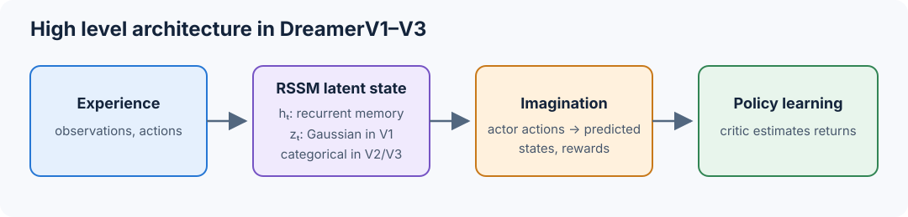
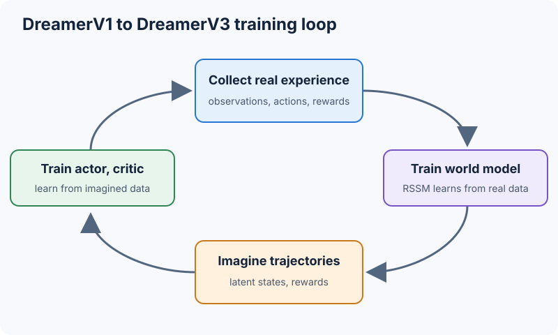
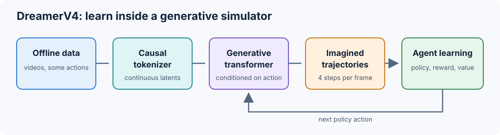

# 10.14 A Primer on the Dreamer Series Model

Traditional reinforcement learning (RL) learns through trial and error: an agent takes an action, observes the outcome, receives a reward, and gradually improves its behavior. While effective, this approach often requires millions of interactions with the environment, making it expensive for applications such as robotics and autonomous driving.

Model-based reinforcement learning (MBRL) addresses this limitation by learning a model of the environment's dynamics. Instead of executing every action in the real environment, an agent can use this learned model to predict future states, evaluate possible actions, and improve its policy through simulated experience.


## Evolution of Dreamer: From Latent Imagination to Generative World Simulation

The Dreamer series builds on MBRL. Dreamer learns a compact representation of the environment and uses a learned dynamics model to predict future states. The agent uses these predictions to train its policy without direct interaction with the environment at every step. DreamerV1 introduced this approach through latent imagination. DreamerV2 improved the latent representations. DreamerV3 focused on training stability and generalization across environments. DreamerV4 introduced a generative video world model that supports policy training from offline data.

The Dreamer series has evolved through four generations, each addressing a specific limitation in learning and using world models for reinforcement learning.

| Model | Why was it needed? | Core architecture | Key innovation |
| --- | --- | --- | --- |
| DreamerV1 (2020) | Model-free RL requires extensive environment interaction, while predicting future images directly is computationally expensive. | Recurrent State-Space Model (RSSM) with continuous Gaussian latents and actor-critic learning | Introduced differentiable latent imagination to train policies without generating full future images. |
| DreamerV2 (2021) | V1 was effective in continuous control but had not achieved comparable success on challenging discrete-action environments such as Atari. | RSSM with discrete categorical latents and actor-critic learning | Introduced categorical latent representations, straight-through gradients, and KL balancing, enabling human-level Atari performance. |
| DreamerV3 (2023) | Earlier methods were sensitive to reward scales, environment characteristics, and hyperparameter choices. | Categorical RSSM and actor-critic learning with improved training stability | Introduced symlog transformations, two-hot predictions, and improved normalization, enabling strong performance across more than 150 tasks with largely fixed hyperparameters. |
| DreamerV4 (2025) | Earlier Dreamer models depended on online environment interaction and compact task-oriented dynamics, limiting their ability to use large-scale offline video data for agent training. | Transformer-based generative video world model, action-conditioned dynamics, and policy learning | Introduced shortcut forcing for efficient generation, learning from unlabeled videos, and offline policy improvement through imagined experience. |

The evolution of Dreamer can be understood through four research questions:

- DreamerV1: Can an agent learn effective behaviors by imagining future trajectories in a compact latent space?
- DreamerV2: Can better latent representations improve world-model learning in challenging environments?
- DreamerV3: Can the same world-model RL algorithm work reliably across diverse environments without extensive task-specific tuning?
- DreamerV4: Can a generative world model trained from offline videos become an interactive simulator in which agents learn complex behaviors?


## DreamerV1: Learning Through Latent Imagination

DreamerV1 (2020) introduced a model-based reinforcement learning approach. Specifically, it uses a Recurrent State-Space Model (RSSM) to learn a latent representation of the environment.

Why latent representation is important here? In model-based reinforcement learning, an agent uses a learned dynamics model to predict the consequences of its actions. These predictions allow the agent to train its policy through simulated experience. However, generating future observations in pixel space can be computationally expensive. Latent imagination addresses this challenge by predicting future states in a compact representation of the environment.

DreamerV1 uses these predicted latent states to train an actor-critic policy. The actor selects actions, and the dynamics model predicts the resulting latent states and rewards. The critic estimates the expected future rewards. The agent repeats this process to generate imagined trajectories. It then uses these trajectories to improve its policy without additional environment interactions during the imagination phase.

### Architecture: Recurrent State-Space Model (RSSM)

DreamerV1 uses the Recurrent State-Space Model (RSSM) introduced in PlaNet. The RSSM combines a deterministic recurrent state with a stochastic latent state. The deterministic state maintains information from previous states and actions. The stochastic state represents uncertainty about the environment using continuous Gaussian variables.

The RSSM learns to predict future latent states and rewards based on the agent's actions. DreamerV1 uses these predictions to generate imagined trajectories and train an actor-critic policy.

### DreamerV1 Training Loop

DreamerV1 uses real experience to train the world model and imagined experience to train the actor and critic.

1. **Collect real experience:** The agent interacts with the environment and stores observations, actions, and rewards in a replay buffer.
2. **Train the world model (real data):** The RSSM learns latent states, environment dynamics, and reward predictions from the replay buffer.
3. **Generate imagined trajectories:** The world model starts from latent states inferred from real observations. The actor selects actions, and the world model predicts future latent states and rewards.
4. **Train the critic (imagined data):** The critic estimates future returns from imagined trajectories.
5. **Train the actor (imagined data):** The actor updates its policy using imagined rewards and critic estimates.
6. **Repeat with real experience:** The updated actor interacts with the real environment to collect new data. The world model learns from the new experience, and the cycle repeats.

Key point here is that real data trains the world model. Imagined data trains the actor and critic. The updated actor then collects new real data to improve the world model.


## DreamerV2: Learning with Discrete Latent Representations

DreamerV1 used continuous Gaussian variables to represent stochastic latent states, showing sample efficiency in continuous-control tasks. Gaussian distributions can be restrictive when the model needs to represent multiple distinct possible outcomes such as in Atari.

To address this challenge, DreamerV2 (2021) replaces continuous Gaussian latent variables with discrete categorical latent variables, while retaining the overall RSSM and actor-critic framework.

### Architecture: From Continuous to Discrete Latents

DreamerV2 uses discrete categorical variables to represent latent states. It uses 32 categorical variables, each with 32 possible categories. These variables allow the model to represent different features and possible outcomes of the environment.

DreamerV2 uses straight-through gradient estimators to train the discrete representations. It also introduces KL balancing to improve the learning of latent dynamics.

### Why Discrete Latents Help

Continuous Gaussian latents represent uncertainty using smooth probability distributions, which can be restrictive when the environment contains several distinct possible outcomes. For example, after an action, an object might remain stationary, move left, or move right. A single Gaussian distribution may struggle to represent these alternatives without averaging across them.

DreamerV2 uses multiple categorical latent variables to represent combinations of features without a Gaussian assumption. Categorical latents are not inherently better than continuous ones; together with improved training and policy optimization, they worked well for learning visual dynamics in Atari.

### DreamerV2 Training Loop

DreamerV2 follows the same training loop as DreamerV1.

What changes in DreamerV2:

- **Latent state:** The RSSM uses categorical variables instead of DreamerV1's Gaussian variables.
- **World-model training:** Straight-through gradients and KL balancing help train the categorical state.

The actor and critic still learn from imagined trajectories, as in DreamerV1.

### Results and Significance

DreamerV2 achieved human-level performance on the 55-game Atari benchmark. Its discrete latent representations and improved training methods demonstrated the effective learning in challenging visual environments.

However, success on Atari is not enough for generalization. Different tasks have different reward scales, action spaces, and dynamics. These differences can require changes to hyperparameters and training methods. DreamerV3 focused on making the same world-model RL algorithm work reliably across diverse environments with minimal task-specific tuning.



*Figure: High level architecture in DreamerV1–V3.*

## DreamerV3: Making World-Model Reinforcement Learning General-Purpose

DreamerV3 (2023) addressed the limitations of DreamerV2 by improving training stability across diverse environments. The goal was to use the same RL algorithm across different tasks, such as Atari, robotics, and Minecraft, with minimal task-specific hyperparameter tuning.

### Architecture: Improving the Existing RSSM

DreamerV3 retains the RSSM architecture with discrete categorical latents and actor-critic learning through imagined trajectories. It introduces several techniques to improve training stability:

- Symlog transformation: Compresses large values to handle different reward and observation scales.
- Two-hot prediction: Represents reward and value targets using distributions over neighboring bins.
- KL balancing and free nats: Stabilize latent learning and reduce the risk of representation collapse.
- Return normalization: Adjusts policy updates to account for differences in reward scales.
- Unimix distributions: Prevent overly confident categorical predictions by adding a small uniform probability.

These improvements allow stable training in DreamerV3 across diverse environments with largely fixed hyperparameters.

### DreamerV3 Training Loop

DreamerV3 follows the same training cycle as DreamerV1 and V2, with its stability techniques applied at different steps:

1. **Collect real experience:** Store observations, actions, and rewards in replay.
2. **Train the world model:** Update the categorical RSSM on real data. Symlog, two-hot reward predictions, KL balancing, free nats, and unimix stabilize this step.
3. **Imagine trajectories:** The actor chooses actions while the RSSM predicts future latent states and rewards.
4. **Train the critic and actor (imagined data):** Two-hot value predictions train the critic; return normalization steadies actor updates.
5. **Repeat:** Use the updated actor to collect more real experience.


### Results and Significance

DreamerV3 demonstrated strong performance across more than 150 tasks using a largely fixed set of hyperparameters.

One of its most notable demonstrations was learning to collect diamonds in Minecraft from scratch, without human demonstrations or a hand-designed curriculum.

Why is this example interesting? Collecting diamonds requires a sequence of interdependent actions, including gathering resources, crafting tools, navigating the environment, and mining. Success therefore requires the agent to learn behaviors that extend beyond immediate rewards.

This demonstrated that latent imagination could support complex, long-horizon decision-making.

### Limitations and Motivation for DreamerV4

DreamerV3 uses online reinforcement learning. It repeatedly collects new observations and actions from the environment to update its world model and policy. This requires continued access to the environment during training.

DreamerV4 (2025) learns a video world model from offline data, then improves its policy through imagined interactions. Policy training needs no new environment interactions.



*Figure: Training loop shared by DreamerV1, V2, and V3.*

## DreamerV4: Training Agents Inside Generative World Models

DreamerV4 (2025) trains an agent inside a world model learned from offline video.

- **Input:** Videos, some with recorded actions.
- **Simulator:** A causal video tokenizer and an action-conditioned generative transformer.
- **Agent:** A policy learns from trajectories generated by the simulator.



*Figure: DreamerV4 generative simulation loop.*


### 1. Architecture Overview

- **Tokenizer:** Compresses video frames into continuous latent tokens.
- **Dynamics model:** Predicts future latents from past latents and actions.
- **Agent:** Predicts actions, rewards, and values for a task.

Training has three stages:

1. Pretrain the tokenizer and dynamics model on video.
2. Add task-conditioned agent predictions.
3. Improve the policy in imagined trajectories.

The function below shows one imagined step:

```python
# One frame-level interface for the three phases. Each callable is trained
# separately or finetuned as described below.
def agent_step(tokenizer, dynamics, policy, frames, task, action):
    # compress the observed frames
    context = tokenizer(frames)                 # [batch, time, latent_dim]
    # predict next frame's latent vector
    next_latent = dynamics(context, action)      # one imagined next frame

    # score possible actions
    action_logits = policy(next_latent, task)
    return next_latent, action_logits
```

### 2. Causal Video Tokenizer

- Compresses frames into continuous latents using masked reconstruction.
- Uses pixel and perceptual losses to preserve visual information.
- Reads the current and earlier frames, never future frames.
- Is frozen during dynamics training.

This simplified mask shows the time constraint; a full tokenizer also needs patch encoding, latent tokens, and a decoder.

```python
import torch


# this function controls what each token can see
# Every token can see all tokens in its own frame and earlier frames, but none in future frames
def block_causal_mask(num_frames: int, tokens_per_frame: int) -> torch.Tensor:
    frame_id = torch.arange(num_frames).repeat_interleave(tokens_per_frame)
    return frame_id[None, :] <= frame_id[:, None]

visible = block_causal_mask(num_frames=3, tokens_per_frame=4)
assert visible[:4, 4:].sum() == 0      # frame 0 cannot see future frames
assert visible[4:8, :8].all()          # frame 1 sees frames 0 and 1


# this function changes the input itself.
# For each patch in each batch item, it randomly decides whether to keep its entire channel vector or replace it with mask_token
def masked_patch_input(patches: torch.Tensor, mask_token: torch.Tensor,
                       drop_probability: float) -> torch.Tensor:
    # patches: [batch, num_patches, channels]
    keep = torch.rand(patches.shape[:2], device=patches.device) >= drop_probability
    return torch.where(keep[..., None], patches, mask_token)
```

### 3. Interactive Dynamics Model

- Predicts the next latent from previous latents and actions.
- Uses spatial attention within frames and causal temporal attention across frames.
- Separates spatial and temporal attention to reduce computation.
- Learns to recover clean future latents from noisy inputs.

This small model shows the two attention directions.

```python
import torch
from torch import nn

class TinyAxialDynamics(nn.Module):
    def __init__(self, latent_dim: int, action_count: int) -> None:
        super().__init__()
        self.action = nn.Embedding(action_count, latent_dim)
        self.spatial = nn.MultiheadAttention(latent_dim, num_heads=2, batch_first=True)
        self.temporal = nn.MultiheadAttention(latent_dim, num_heads=2, batch_first=True)

    def forward(self, tokens: torch.Tensor, actions: torch.Tensor) -> torch.Tensor:
        # tokens: [batch, time, spatial_tokens, latent_dim]
        batch, time, spatial_tokens, width = tokens.shape
        x = tokens + self.action(actions)[:, :, None, :]
        # Spatial attention: group each frame's patches into one sequence.
        # Shape: [batch * time, spatial_tokens, width].
        x = x.reshape(batch * time, spatial_tokens, width)
        x, _ = self.spatial(x, x, x, need_weights=False)

        # Temporal attention: group each patch position across frames.
        # Shape: [batch * spatial_tokens, time, width].
        x = x.reshape(batch, time, spatial_tokens, width).transpose(1, 2)
        x = x.reshape(batch * spatial_tokens, time, width)
        # Mask future frames so each time step sees only itself and the past.
        future = torch.triu(torch.ones(time, time, dtype=torch.bool,
                                      device=tokens.device), diagonal=1)
        x, _ = self.temporal(x, x, x, attn_mask=future, need_weights=False)
        return x.reshape(batch, spatial_tokens, time, width).transpose(1, 2)
```

### 4. Shortcut Forcing

- **Problem:** Generating each frame with many refinement steps is too slow for RL.
- **Method:** Learn larger generative steps from smaller ones and predict the clean latent.
- **At inference:** Generate each new frame representation in four model calls.

The example shows a shortcut training target and a four-step sampler.

```python
import torch
import torch.nn.functional as F

def velocity(noisy, predicted_clean, tau):
    # Turn a clean-latent prediction into a direction from the current noisy latent.
    return (predicted_clean - noisy) / (1 - tau)

def shortcut_loss(predict_clean, noisy, clean, tau, step, actions, finest):
    # Train the model to predict the clean latent for the requested step size.
    predicted = predict_clean(noisy, tau, step, actions)
    if step == finest:
        # At the smallest step size, compare directly with the known clean latent.
        error = F.mse_loss(predicted, clean, reduction="none")
    else:
        with torch.no_grad():
            # Use two half steps to build a target for one larger shortcut step.
            half = step / 2
            first = velocity(noisy, predict_clean(noisy, tau, half, actions), tau)
            middle = noisy + half * first
            second = velocity(middle, predict_clean(middle, tau + half,
                                                    half, actions), tau + half)
            target_velocity = (first + second) / 2
        # Match the large step's direction to the two-half-step direction.
        error = (velocity(noisy, predicted, tau) - target_velocity).square()
        # Undo the 1 / (1 - tau) scale introduced by velocity().
        error = (1 - tau).square() * error
    # Weight examples by their position along the noise-to-clean path.
    return ((0.9 * tau + 0.1) * error).mean()

def sample_four_steps(predict_clean, shape, actions, device):
    # Start from noise and move toward a clean latent in four equal steps.
    latent = torch.randn(shape, device=device)
    for index in range(4):
        tau = index / 4
        predicted = predict_clean(latent, tau, 0.25, actions)
        # Euler update: current latent + step size * predicted direction.
        latent = latent + 0.25 * velocity(latent, predicted, tau)
    return latent
```

### 5. Videos Without Action Labels

- Unlabeled video teaches the model how scenes change.
- Action-labeled video teaches it how controls cause those changes.
- A learned placeholder represents missing actions during training.

```python
import torch
from torch import nn

action_embedding = nn.Embedding(12, 32)
# One trainable vector stands in for every action label missing from a video.
unknown_action = nn.Parameter(torch.zeros(32))

def action_token(action_id: torch.Tensor, has_label: torch.Tensor) -> torch.Tensor:
    recorded = action_embedding(action_id)
    # Keep the recorded embedding where a label exists; otherwise use the placeholder.
    return torch.where(has_label[..., None], recorded, unknown_action)

ids = torch.tensor([[2, 5], [0, 0]])
labeled = torch.tensor([[True, True], [False, False]])
assert torch.equal(action_token(ids, labeled)[1, 0], unknown_action)
```

### 6. Agent Finetuning

- Task tokens let the agent predict actions and rewards for a goal.
- Agent tokens read world-model tokens; world-model tokens cannot read task tokens.
- Behavior cloning gives the policy a useful starting point.
- Value predictions support the later imagination phase.

This mask shows the one-way attention. The heads below use recorded actions and rewards.

```python
import torch
import torch.nn.functional as F
from torch import nn

def agent_attention_mask(video_tokens: int, agent_tokens: int) -> torch.Tensor:
    count = video_tokens + agent_tokens
    blocked = torch.zeros(count, count, dtype=torch.bool)
    # True blocks video-token queries from reading agent-token keys.
    # Agent-token queries may still read video tokens.
    blocked[:video_tokens, video_tokens:] = True  # query rows, key columns
    return blocked

# Stand-in hidden states for four training examples.
hidden = torch.randn(4, 16)
policy_head = nn.Linear(16, 8)
reward_head = nn.Linear(16, 1)
recorded_actions = torch.tensor([1, 2, 3, 4])
recorded_rewards = torch.tensor([0.0, 1.0, 0.0, 2.0])
# Copy recorded actions and predict recorded rewards from the same hidden states.
clone_loss = F.cross_entropy(policy_head(hidden), recorded_actions)
reward_loss = F.mse_loss(reward_head(hidden).squeeze(-1), recorded_rewards)
loss = clone_loss + reward_loss
```

The paper uses richer action and reward predictions; the scalar reward head here shows the basic loss.

### 7. Imagination Training

Starting from an offline observation, the agent repeats this loop:

1. Choose an action with the policy.
2. Generate the next latent with the world model.
3. Predict its reward and value.
4. Update the policy from imagined returns.

- **PMPO:** Uses the sign of the estimated advantage to favor better actions.
- **Behavior prior:** Keeps the policy near the offline behavior distribution.
- **Fixed simulator:** The world model stays frozen while policy and value heads learn.

This example shows imagined rollouts, return targets, and the PMPO loss.

```python
import torch
import torch.nn.functional as F

def imagine(context, policy, sample_next, reward_model, value_model, steps):
    states, actions, rewards, values = [], [], [], []
    for _ in range(steps):
        # Save the current state and its value before choosing an action.
        states.append(context)
        values.append(value_model(context))
        action = policy(context).sample()
        actions.append(action)
        # Move through the learned world model, then score the resulting state.
        context = sample_next(context, action)  # four shortcut steps
        rewards.append(reward_model(context))
    # The final state's value estimates rewards beyond this imagined rollout.
    values.append(value_model(context))          # bootstrap after the horizon
    return states, actions, rewards, values

def lambda_returns(rewards, values, continues, gamma=0.997, lam=0.95):
    # Work backward from the final value estimate to get a target per time step.
    target = values[-1]
    returns = []
    for t in reversed(range(len(rewards))):
        # continues[t] is zero if the imagined episode ends after this step.
        target = rewards[t] + gamma * continues[t] * (
            (1 - lam) * values[t + 1] + lam * target
        )
        returns.append(target)
    # Reverse the collected targets back into chronological order.
    return torch.stack(returns[::-1])

def pmpo_loss(policy_logits, prior_logits, sampled_actions, advantages,
              alpha=0.5, beta=0.3):
    log_prob = torch.distributions.Categorical(logits=policy_logits).log_prob(sampled_actions)
    # Favor sampled actions with nonnegative advantage; suppress the others.
    positive = advantages.detach() >= 0
    negative = ~positive
    pos_loss = -alpha * log_prob[positive].mean() if positive.any() else log_prob.sum() * 0
    neg_loss = (1 - alpha) * log_prob[negative].mean() if negative.any() else log_prob.sum() * 0
    # Keep the learned policy near the frozen offline behavior prior.
    log_policy = F.log_softmax(policy_logits, dim=-1)
    log_prior = F.log_softmax(prior_logits.detach(), dim=-1)
    reverse_kl = (log_policy.exp() * (log_policy - log_prior)).sum(-1).mean()
    return pos_loss + neg_loss + beta * reverse_kl
```

The next helper makes the frozen and trainable parts explicit.

```python
def configure_imagination_training(tokenizer, dynamics, reward_head,
                                   behavior_prior, policy_head, value_head):
    # Keep the world model, reward model, and behavior prior fixed.
    for module in (tokenizer, dynamics, reward_head, behavior_prior):
        module.eval()
        module.requires_grad_(False)
    # Update only the policy and value heads from the imagined rollouts.
    for module in (policy_head, value_head):
        module.train()
        module.requires_grad_(True)
```

### 8. Results: Minecraft Diamonds

- The agent learns from offline data and improves through imagined trajectories.
- It collects diamonds when evaluated in Minecraft, a long-horizon task.
- Evaluation uses the real game; the sample calculation below uses illustrative values, not paper results.

```python
import torch

obtained_diamond = torch.tensor([False, False, True, False, True])
# Converting success flags to floats makes their mean the fraction of successes.
success_rate = obtained_diamond.float().mean().item()
print(f"Diamond success: {success_rate:.1%} over {len(obtained_diamond)} episodes")
```

### 9. Remaining Challenges

- **Long rollouts:** Prediction errors accumulate over time.
- **Action accuracy:** Plausible video can show the wrong result of an action.
- **Unfamiliar actions:** Offline data may not cover actions the new policy chooses.
- **Compute:** Large generative models remain expensive to train.
- **Transfer:** Minecraft results do not establish performance in robotics.

The diagnostic below measures how latent prediction error grows with rollout length.

```python
import torch

def rollout_error(predicted_latents: torch.Tensor,
                  observed_latents: torch.Tensor) -> torch.Tensor:
    if predicted_latents.shape != observed_latents.shape:
        raise ValueError("Predicted and observed sequences must have the same shape")
    if predicted_latents.ndim < 3:
        raise ValueError("Expected [batch, time, ...] latent sequences")
    # Flatten latent features, then average squared error over batch and features.
    # Keep the time axis so the result shows error at each rollout step.
    return (predicted_latents - observed_latents).square().flatten(2).mean((0, 2))

predicted = torch.randn(2, 4, 8)
observed = torch.randn(2, 4, 8)
error_by_horizon = rollout_error(predicted, observed)
assert error_by_horizon.shape == (4,)
```

### Takeaway

DreamerV4 learns a generative simulator from offline video, then improves a policy through imagined experience. Its usefulness depends on how accurately the simulator predicts the effects of actions.

### Primary sources

- [DreamerV1: Dream to Control](https://arxiv.org/abs/1912.01603)
- [DreamerV2: Mastering Atari with Discrete World Models](https://arxiv.org/abs/2010.02193)
- [DreamerV3: Mastering Diverse Domains through World Models](https://arxiv.org/abs/2301.04104)
- [DreamerV4: Training Agents Inside of Scalable World Models](https://arxiv.org/abs/2509.24527)
